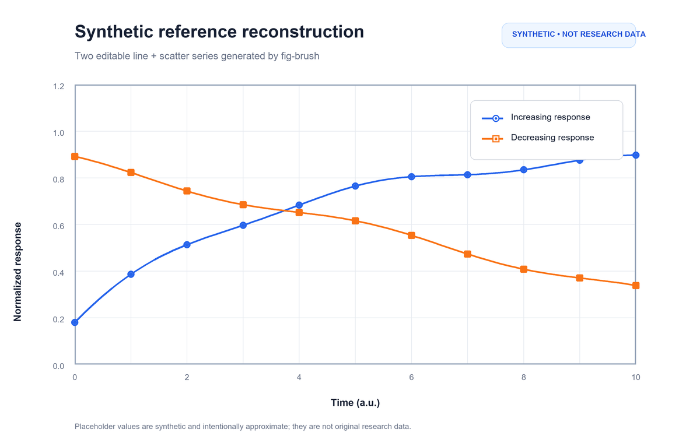

# fig-brush

fig-brush is a Codex plugin and Python package that works like a visual format
brush for Origin. It reads the visible style of a scientific figure reference
and produces a one-page `APPLY_FORMAT.md` guide plus a compact, reusable
`format_parameters.json` bundle. A native Origin graph template (`.otpu`),
style manifest, and editable `.opju` demo are optional exports. The user can
apply the visual format to a compatible graph in their own Origin workbook
without giving fig-brush their research data.

**Version:** 0.3.3<br>
**License:** [Apache License 2.0](LICENSE)  
**Maintainer:** Petey Yu



The image above is a synthetic example included for documentation. It does
not represent a paper, an experiment, or recovered research data.

## Workflow

The default workflow is deliberately small: one reference image in, one
reviewable parameter bundle out. No CSV, XLSX, Origin project, or private
research data is needed.

1. Give fig-brush a PNG or JPEG reference figure.
2. Run `format-brush` (or call the `format_brush` MCP tool). It measures the
   canvas, plot frame, axes, ticks, typography, and palette and writes two JSON
   files plus a one-page `APPLY_FORMAT.md` instruction sheet.
3. Open `APPLY_FORMAT.md` and follow its short Origin checklist. It points to
   the values in `format_parameters.json`; `reference_analysis.json` is only
   optional audit evidence. Keep your own data and statistics in Origin.
4. If a native reusable `.otpu` is needed, pass a completed reference-only
   `TemplateSpec` and `--render-origin`; this is an optional export step and
   still does not read the user's data.

For example:

```powershell
python scripts\origin_plot_cli.py format-brush reference.png output
```

If you already have an Origin project with your own graph, apply the generated
format in one command. The input project is copied; it is never overwritten:

```powershell
python scripts\origin_plot_cli.py apply-format my_graph.opju output\format_parameters.json
```

Open the returned `my_graph_formatted.opju` to review the result. The same
operation is available as the `apply_format` MCP tool. It changes page, layer,
axis, and typography appearance while retaining the project's data, labels,
axis limits, and series colours.

For a no-script workflow, open the user's graph in Origin and ask Codex to
“paste this format into the current Origin graph”. The `apply_active_format`
MCP tool applies the parameter bundle to the active graph, keeps the project
unsaved, and leaves the final Save action in Origin. If a native reference
`.opju` is available, `stage_format_clipboard` can instead prepare Origin's
own format clipboard so the user can switch graphs and use Origin's existing
right-click **Paste Format** command.

The existing lower-level inspection, data-compatibility, rendering, and
verification commands remain available for older integrations, but they are
not required for the format-brush workflow.

The MCP server exposes the compact tools by default. Set
`FIG_BRUSH_ENABLE_LEGACY_TOOLS=1` only when an older integration needs the
data-driven or replacement tools.

When native export is requested, fig-brush writes `result.opju` alongside the
native template as a visual reference and editable demo; it is not the user's
data file. The default `format-brush` path does not create an Origin project.
The optional replacement bundle and `refresh_reference_template` tool are
available when a researcher explicitly chooses to map local tables into the
demo project.

When native preview export is requested, any generated values are visual
placeholders. They preserve visible ranges, marker counts, and layout cues;
they are **not** the original measurements or the original paper's statistical
results. A smooth line is treated as a candidate reconstruction hypothesis
unless the user supplies evidence for its model.

## Quick start on Windows

Requirements:

- Windows 10 or 11;
- Python 3.10 or newer;
- Pillow and the Python dependencies installed by `scripts\setup.ps1`;
- Origin 2021 or newer with a valid local license, plus `originpro` in the same
  environment, only when native `.otpu`/`.opju` export is requested.

From the repository root, run the setup script. It creates a versioned,
per-user runtime under `%LOCALAPPDATA%\fig-brush\runtimes` (or `PLUGIN_DATA`
when Codex provides it) and installs the local package there. Use `-Dev` to
include test and build dependencies:

```powershell
.\scripts\setup.ps1
# or: .\scripts\setup.ps1 -Dev
```

Check the installed environment before starting Codex:

```powershell
$python = .\scripts\ensure_runtime.ps1 -PluginRoot .
& $python scripts\doctor.py --plugin-root .
& $python scripts\check_mcp.py --plugin-root . --python $python
```

The doctor returns `0` when the screenshot-template workflow is ready. A
missing Origin installation is reported as an optional warning for the
image/spec preparation path; pass `--require-origin` when native `.otpu` and
`.opju` artifacts are required. Use `--json` for machine-readable output.

To install a published GitHub release, download the matching
`fig-brush-<version>.zip` asset and its `.sha256` sidecar, extract the archive,
open the extracted `fig-brush` directory, and run the same setup script. The
Codex launcher can also bootstrap this per-user runtime on first start from
the installed marketplace copy.

Run the synthetic example without Origin after selecting the runtime Python:

```powershell
$python = .\scripts\ensure_runtime.ps1 -PluginRoot .
& $python examples\synthetic\run_example.py
```

The optional `--render-origin` flag asks the local Origin bridge to create a
native project. It requires a working Origin installation and `originpro` in
the same per-user runtime:

```powershell
$python = .\scripts\ensure_runtime.ps1 -PluginRoot .
& $python examples\synthetic\run_example.py --render-origin
```

For a local Codex/MCP installation, configure the plugin from this checkout.
The repository `.mcp.json` starts `scripts/run_mcp.ps1`. The launcher resolves
the installed plugin root and bootstraps the same versioned per-user runtime;
it does not write diagnostics to MCP stdout.

### Register the local Codex marketplace

This repository includes a repo-scoped marketplace at
`.agents/plugins/marketplace.json`. After running the setup script, register
the checkout as a local marketplace from PowerShell:

```powershell
codex plugin marketplace add "C:\path\to\fig-brush"
codex plugin marketplace list
```

Open Codex's Plugins Directory, select **fig-brush Local**, and install
`fig-brush`. Start a new chat after installation. Keep the checkout available
as the marketplace source so Codex can refresh it when you upgrade.

To refresh an installed copy after pulling changes, upgrade the marketplace
and restart Codex if the update is not visible immediately:

```powershell
codex plugin marketplace upgrade fig-brush-local
```

To remove the local source from Codex, uninstall `fig-brush` from the Plugins
Directory, then remove the marketplace registration:

```powershell
codex plugin marketplace remove fig-brush-local
```

The launcher keeps one runtime per plugin version. After uninstalling the
plugin, inspect or remove only those runtime folders with
`scripts\cleanup_runtime.ps1`; it does not touch generated projects or
research data:

```powershell
.\scripts\cleanup_runtime.ps1
.\scripts\cleanup_runtime.ps1 -Version 0.3.3 -Confirm
```

Install the third-party `originpro` package according to the package's
supported distribution instructions when native Origin automation is needed.
Use the runtime Python printed by `setup.ps1` (or by `ensure_runtime.ps1`),
rather than a different global Python environment.
fig-brush does not bundle Origin, OriginLab software, or the `originpro`
package.

## What fig-brush can and cannot infer

fig-brush can preserve visible page and plot-frame geometry, axis scales and
ticks, typography and rich text, legends, common line/scatter/column,
histogram, box/violin, heatmap, pie/doughnut, and regression structures in the
graph template. It also supports explicit candidate fits such as linear,
Boltzmann, and 4PL when the caller requests them; these are preview hypotheses
and are not needed to use the visual template.

It is a rendering bridge, not a universal scientific-figure recognizer. A
screenshot alone does not establish the original numbers, fit algorithm,
normalization, significance test, uncertainty definition, or domain meaning.
Automatic OCR, marker/legend segmentation, and reliable reconstruction of
arbitrary 3-D, contour, survival, broken-axis, dark-theme, or complex
multi-panel figures are outside the current boundary. See
[`docs/capabilities.md`](docs/capabilities.md) for the maintained capability
matrix.

The native path also includes an active-graph bridge for an Origin add-in: it
can apply the generated visual parameters to the graph currently selected in
Origin without opening, replacing, or saving the user's project. The bridge
preserves data, labels, axis ranges, and statistics and leaves saving to the
user. The optional one-click Origin extension described in
[`docs/origin-one-click.md`](docs/origin-one-click.md) can expose that bridge as
`Fig-brush → 粘贴参考格式` in the graph context menu.

## Outputs and data handling

The compact format-brush workflow has two JSON outputs and one human-facing
apply sheet:

| Output | Purpose | Contains user data? |
| --- | --- | --- |
| `format_parameters.json` | Directly usable, Origin-oriented page/layer/axis/plot style parameters | No |
| `reference_analysis.json` | Auditable image measurements and confidence hints behind the parameters | No |
| `APPLY_FORMAT.md` | One-page Origin checklist generated from the parameter file | No |

When native export is explicitly requested, the output folder also contains:

| Output | Purpose | Contains user data? |
| --- | --- | --- |
| `style_template.otpu` | Start a compatible Origin graph with the measured page, layer, axis, text, marker, line, column, and annotation styling | No |
| `style_manifest.json` | Reviewable record of the visual decisions and any limits of the reconstruction | No |
| `result.opju` and previews | Optional companion demo for inspecting the style with synthetic placeholder marks | No; placeholders only |

Multi-panel references emit one `<Panel>_style.otpu` per Origin graph page;
single-panel references use `style_template.otpu`.

Origin graph templates store graph appearance and layout, with a compatible
input and plot structure expected by the template. See OriginLab's
[graph-template basics](https://docs.originlab.com/origin-help/graph-template-basics/)
and [template elements](https://docs.originlab.com/origin-help/graph-template-elements/)
for the native template model. Apply the generated template to a copy of the
user's workbook first, then check data binding, plot roles, axis ranges, and
categorical order for the chosen graph family. A mixed summary-and-raw-point
figure needs explicit role mapping when the user's workbook uses different
columns or plot layers.

The screenshot-template workflow does not upload a private dataset and does
not require one: it creates synthetic placeholder values from the visible
reference. The screenshot and tool results may still be processed by the
Codex host/model according to that host's policies, so this project should not
be described as universally offline. Review your host's data controls before
using sensitive images.

An optional compatibility/data-inspection path can read a CSV or XLSX path
explicitly provided by the user. The optional replacement bundle uses
conventional `Raw_Data.csv`, `Summary_Data.csv`, or `XY_Data.csv` files and is
documented in [`docs/data-contract.md`](docs/data-contract.md). That path is a
convenience for users who want local data mapping; it is not required to obtain
or apply the visual format brush. Do not commit private CSV, XLSX, PNG, PDF, or
`.opju` files.

## Documentation

- [Installation and MCP setup](docs/installation.md)
- [Visual format-brush workflow](docs/format-brush.md)
- [Scientific reconstruction contract](docs/scientific-reconstruction.md)
- [Replacement data contract](docs/data-contract.md)
- [Capability matrix and known limits](docs/capabilities.md)
- [Supported graph families](docs/supported_graphs.md)
- [Text layout](docs/text-layout.md)
- [Error bars](docs/error-bars.md)
- [Candidate confidence bands](docs/confidence-bands.md)
- [Troubleshooting](docs/troubleshooting.md)

## Development

```powershell
.\scripts\setup.ps1 -Dev
$python = .\scripts\ensure_runtime.ps1 -PluginRoot . -Dev
& $python -m pytest
python scripts\package_plugin.py
```

The package exposes the `fig-brush` command and the `python -m fig_brush`
entry point. CI validates the manifest, runs the Python tests, and builds the
plugin archive.

## License and third-party software

fig-brush source and documentation are released under Apache-2.0. Origin and
OriginLab products are third-party commercial software and require their own
license. `originpro` is a separately distributed third-party Python package;
consult the terms shipped with the version you install. See
[`NOTICE`](NOTICE) and [`THIRD_PARTY_NOTICES.md`](THIRD_PARTY_NOTICES.md).
fig-brush is an independent project and is not affiliated with OriginLab,
OpenAI, or Codex.

## Citation

If fig-brush contributes to published work, cite the metadata in
[`CITATION.cff`](CITATION.cff).
